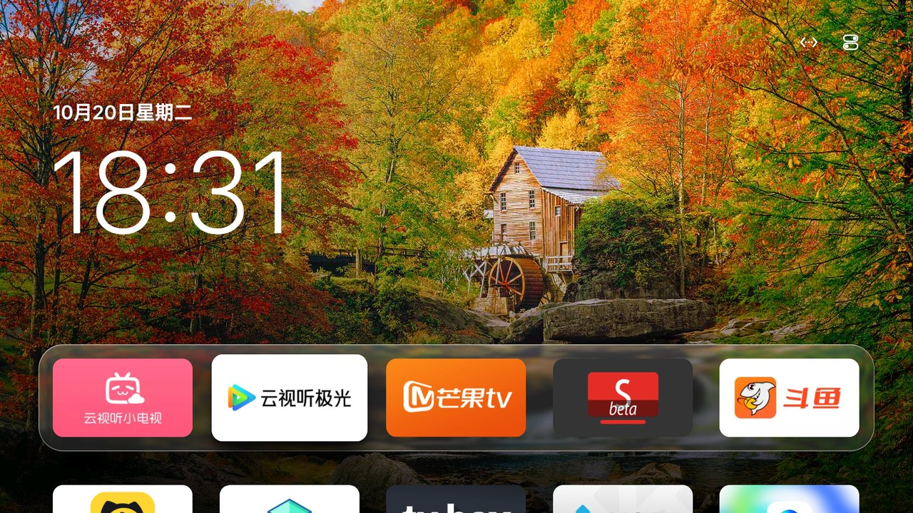
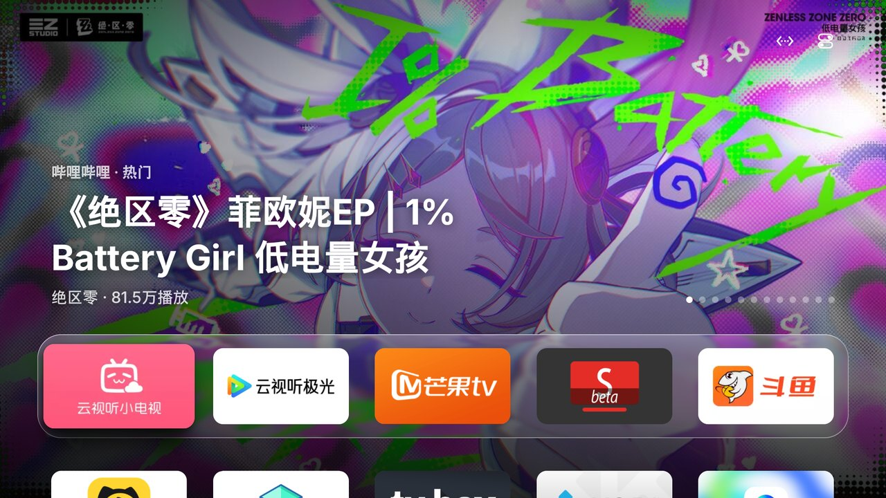
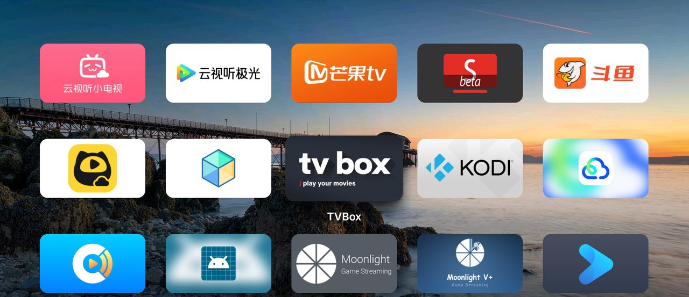
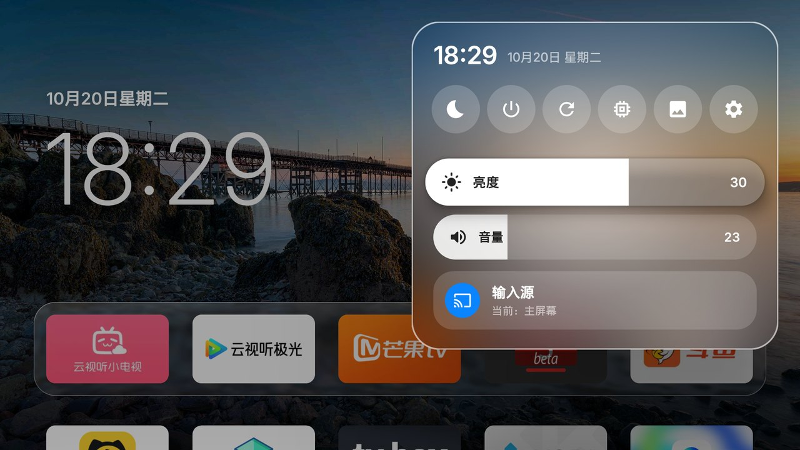

# Tigris

把 Android TV 的桌面换成 tvOS 26 的样子：沉底的 Liquid Glass Dock、Top Shelf 式的顶部内容、毛玻璃控制中心、风景照片背景和相框屏保。

> 十二生肖开源系列第三个项目：虎。Tigris 是拉丁语和希腊语里的"老虎"。

**已在索尼 BRAVIA XR-55A80J（Android TV 12）上完整验证。** 其他品牌的电视，交给 AI Agent 按 [AGENTS.md](AGENTS.md) 安装和适配，见下文。



## 效果图

| 顶部内容（Top Shelf） | 展开全部 App |
|---|---|
|  |  |
| **控制中心** | **相框 / 屏保** |
|  |  |

## 让 AI Agent 帮你安装

### 第一步：打开电视的 ADB 调试

电脑和电视连同一个网络。先在电视上找到 IP 地址（一般在「设置 → 网络」或「关于」里），再打开 ADB：

| 电视 | 怎么打开 |
|---|---|
| **小米 / Redmi** | 设置 → 关于 → **产品型号**，连续按确认键，直到提示已进入开发者模式。再到 设置 → 账号与安全，打开 **ADB 调试** 和 **安装未知来源的应用** |
| **TCL / 雷鸟** | 设置 → 关于 → **本机信息**，依次按遥控器的 **上、下、左、右**（间隔不超过 1 秒），底部会出现「更多」，在里面打开 **ADB** |
| **索尼 BRAVIA** | 设置 → 系统 → 关于 → 在 **版本**（Android TV 操作系统版本）上连按确认键 7 次；再到 设置 → 系统 → 开发者选项，打开 **USB 调试** |
| **原生 Android TV / Google TV**、海信等 | 设置 → 设备偏好设置 → 关于 → 连续按 **版本号** 7 次；再到 开发者选项 打开 **USB 调试**（也可能叫「网络调试」或「ADB 调试」） |

电脑第一次连接时，电视会问「允许 USB 调试吗？」，选 **允许** 并勾上「始终允许」。小米每次待机唤醒都会自动关掉 ADB，装好 Tigris 后可以在设置里打开「保持 ADB 调试开启」。

### 第二步：交给 Agent

把下面这句话和仓库链接发给 Codex、Claude Code 这类能执行命令的 Agent 即可：

> 按 https://github.com/lesnolie/Tigris 的 AGENTS.md 把 Tigris 装到我的电视上，电视 IP 是 192.168.x.x

Agent 会按 [AGENTS.md](AGENTS.md) 一步步完成：连接电视、安装、设为默认桌面、授权，以及索尼电视的额外配置。过程中电视上会弹出两三次确认框，需要你用遥控器点"允许"。TCL 电视上会弹出「多屏互动：正在发起应用推送」，选「同意」。

## 功能

- **主屏幕**：右上角显示时间、网络和可开关的 Apple 风格默认头像，选中头像可打开主屏幕设置；底部是 5 列 16:9 圆角图标。选中时图标放大、倾斜并带投影。头像可在「主屏幕设置 → 显示右上角头像」中开关。
- **编辑主屏幕**：长按图标进入编辑，用方向键把它拖到任意位置，拖进 Dock 就成了常用 App，和 iPhone、Apple TV 的排列方式一样。
- **删除 App，包括预装的**：长按菜单可以直接删除 App，连电视预装、系统设置里删不掉的也可以（`pm uninstall --user 0`，系统分区里的安装包还在）。删掉的预装 App 不再出现，也不会在后台运行；随时可以在"主屏幕设置 → 已删除的预装 App"里恢复。电视运行必需的组件（设置、电视播放器、输入源、桌面）不提供删除。
- **Liquid Glass Dock**：第一排 App 放在沉底的玻璃板上，下一排只露出上沿，按下键展开全部 App。玻璃的模糊、边缘折射和彩色高光在 CPU 上按当前背景预先算好（Android 12 没有运行时着色器），所以滚动时不额外占用 GPU。
- **顶部内容**：选中 Dock 里的部分 App 时，上半屏轮播它的内容：
  - 云视听小电视：哔哩哔哩热门视频
  - 斗鱼：正在直播的热门直播间

  内容来自这两个服务公开的网页接口，因为国内 App 基本不往 Android TV 的系统频道接口里写数据。
- **控制中心**（遥控器返回键或右上角按钮）：独立悬浮的液态玻璃按钮，没有整块底板；Android 12 及以上通过共享 GPU 模糊图层实时显示背后的桌面，较旧系统使用背景采样；选中时显示玻璃高光。包括网络、待机、关机、重启、释放内存、相框、设置，以及亮度、音量和 HDMI 输入源。
- **背景**：必应每日风景照，或 Wallhaven 本月热门二次元壁纸（只取全年龄），每天自动下载，可设置每 15 分钟到 1 天换一张；也可以选纯色渐变。相框屏保跟随所选的图源。
- **壁纸**：主屏幕上的「壁纸」（或 设置 → 背景）把所有背景排成预览图，选中按一下就换，不用再一个个按过去。右边是二维码，手机扫码打开一个网页：
  - 上传手机里的照片，作为「我的照片」背景和屏保；
  - 填自己的图片链接（每行一个），电视每天自动去取。可以是一张图片的地址、每次返回不同图片的随机图接口，或者列出图片地址的网页 / JSON；
  - 选背景和屏保。

  网页只在这个页面打开时（以及之后 5 分钟）可用，地址里带随机口令，局域网里其他设备猜不到。
- **相框 / 屏保**：全屏轮播照片，画面缓慢平移缩放，时间文字会定时挪动位置，防止 OLED 烙印；也可以换成 **Apple TV 航拍视频**（从 Apple 服务器在线播放，地点名随镜头变化，左右键切换，断网时自动换回照片）。可以手动打开，也可以设为系统屏保：在「主屏幕设置 → 空闲多久显示相框」选 1 到 30 分钟，遥控器这么久没按就自动进入相框（播放视频时不会打断）。
- **HDMI 输入源放上主屏幕**：控制中心 → 输入源 → 「在主屏幕上显示…」，选中的输入源会变成主屏幕上的图标，按一下就切过去。
- **桌面守护**（小米、TCL 等国产电视）：见下文。
- **内存清理**：定时清理，电视待机时也会清理一次，保留名单可在设置中修改。

## 哪些功能所有电视都能用

| 功能 | 任意 Android TV（Android 9+） | 需要本机调试授权 | 仅索尼 BRAVIA |
|---|:-:|:-:|:-:|
| 主屏幕、Dock、玻璃效果、投影 | ✅ | | |
| 顶部内容（B站 / 斗鱼） | ✅ 需要装对应的 TV 版 App | | |
| 风景 / 二次元背景、相框 | ✅ | | |
| 控制中心界面、时钟 | ✅ | | |
| 释放内存 | ✅ 只能清理缓存 | ✅ 彻底结束后台 App | |
| 删除预装 App | | ✅ | |
| 待机、关机、重启 | | ✅ | |
| 把相框设为系统屏保、空闲时长 | | ✅ | |
| 音量滑条 | ✅ Android 标准音量 | | ✅ 电视音量 |
| HDMI 输入源切换 | ✅ 大多数电视 | | ✅ 还能显示当前输入源 |
| 亮度（背光）滑条 | 小米（需 ADB 授权） | | ✅ |
| 桌面守护、被杀后自动复活 | 需要电脑 ADB 授权一次，或本机调试授权 | ✅ | |

- **本机调试授权**：App 会连接电视自己的 adb（`127.0.0.1:5555`，基于 [dadb](https://github.com/mobile-dev-inc/dadb)）来执行系统命令。前提是电视在开发者选项里打开了"网络调试 / ADB 调试"。首次使用时电视会弹出"允许调试吗？"，勾选"始终允许"即可。这个机制在各品牌电视上都通用。
- **索尼**：电视有 BRAVIA IP 控制接口（`http://127.0.0.1/sony/`）时，亮度、音量和输入源都走这个接口。
- **TCL / 雷鸟国行固件**（社区在雷鸟 75R685C 上验证，[#1](https://github.com/lesnolie/Tigris/pull/1)）：系统没有注册标准输入源，输入源一栏会打开 TCL 自己的信号源选择器；"系统设置"打开 TCL 设置；没有可用的背光接口，亮度滑条隐藏。这类固件拒绝 `adb install`（`INSTALL_FAILED_VERIFICATION_FAILURE`），另一个第三方桌面保持启用时，冷启动后可能弹出桌面选择，用 `pm disable-user` 停用它即可。
- **小米 / Redmi 国行固件**（按 [Aerial](https://github.com/pengchujin/aerial-tv) 的机型笔记移植，我们没有实机验证）：背光走 `picture_backlight`，输入源走小米播放器，"系统设置"和 Wi-Fi 打开小米自己的设置；小米应用商店、高清播放器、米家这些没有标准启动入口的系统 App 也会出现在主屏幕上。小米显示自己的（带广告的）屏保而不是 Android 的，Tigris 会在它出现前 15 秒先打开相框。
- **其他品牌**：自动改用 Android 标准接口。音量用 `AudioManager`；输入源用 `TvInputManager` 列出 HDMI 口，再交给系统的电视播放器切换。Android 没有调背光的标准接口，所以亮度滑条会隐藏。用功放（ARC/eARC）时，标准音量调的可能是电视本身而不是功放。

### 国产电视（非原生 Android TV 系统）：桌面守护

小米、TCL、海信、创维等国产电视大多只认自家桌面：小米上 `set-home-activity` 显示成功但不生效，按主页键照样回 PatchWall；待机时还会强制停止所有第三方 App。**千万不要停用小米自带桌面**（`com.mitv.tvhome`），否则开机黑屏。

Tigris 的做法来自 [Aerial](https://github.com/pengchujin/aerial-tv) 在小米和 TCL 实机上验证过的方案，不需要 root，不卸载、不停用任何系统应用：

1. **桌面守护**（无障碍服务「主屏幕守护」）：原厂桌面一到前台，就把 Tigris 拉回来，大约闪半秒。它只看窗口切换，不读屏幕内容。开机或唤醒时会先等 1.5 秒，游戏机、盒子通过 HDMI-CEC 切走信号源时不会被打断。主屏幕上原厂桌面的图标仍然能打开原厂桌面。
2. **被杀后复活**：注册了一个通知监听（不读任何通知）。系统杀掉 Tigris 后约半秒会重新绑定它，Tigris 随之复活，并重新打开守护。开机时也靠它自动启动。
3. **保持 ADB 开启**（可选）：小米唤醒后会关掉 ADB 调试，Tigris 马上重新打开，方便以后升级。
4. **TCL**：TCL 拒绝一切 `adb install`，也拒绝声明为桌面的 App。为此有一个 **guard 版**（`Tigris-guard.apk`，不声明 HOME，靠守护保持在前台），通过电视自带的「多屏互动」推送安装（[`tools/tcast-push.py`](tools/tcast-push.py)），电视上点一次「同意」即可。TCL 默认拦截第三方 App 开机自启，安装时会用 `appops` 放行。

守护默认关闭。Agent 安装时会按 [AGENTS.md](AGENTS.md#10-tvs-whose-system-fights-third-party-launchers-the-home-guard) 授权并打开；也可以在 设置 → 桌面守护 里自己打开（需要先完成本机调试授权）。这一项只在小米、TCL 或 Tigris 不是默认桌面的电视上出现，「保持 ADB 调试开启」只在小米上出现；索尼等原生 Android TV 上看不到它们。小米和 TCL 的部分是按 Aerial 的实机笔记移植的，我们自己没有这两种电视，遇到问题欢迎提 issue。

需要电脑通过 ADB 授予的权限：

| 权限 | 用途 |
|---|---|
| `WRITE_SECURE_SETTINGS` | 重新打开被系统关掉的守护；保持相框为系统屏保；保持 ADB 开启；写入小米的背光值 |
| 通知监听 | 被强制停止或开机后由系统拉起，不读取任何通知 |
| 悬浮窗（`SYSTEM_ALERT_WINDOW`） | 开机后从后台打开主屏幕 |
| TCL `APP_AUTO_START` / `APP_ASSOC_START` | 允许开机自启（只有 TCL 有） |

### 想兼容其他品牌电视

这三项都在 [`TvControls.kt`](app/src/main/java/com/leslie/tvhome/TvControls.kt) 里：先试索尼接口，不行再用 Android 标准接口。要支持某个品牌自己的接口（比如背光），在这里加一个分支就行。

不会写代码也没关系。把下面这句话发给 Agent，它会按 [AGENTS.md 的"适配"一节](AGENTS.md#9-adapting-tigris-to-a-tv-that-isnt-fully-supported)，在你的电视上查找可用的接口、改代码、编译、安装并验证：

> 按 https://github.com/lesnolie/Tigris 的 AGENTS.md 安装 Tigris，如果亮度/音量/输入源在我的电视上不能用，帮我适配。电视 IP 是 192.168.x.x

适配成功后，欢迎提交 PR，让同品牌的人都能用上。

## 手动构建和安装

需要 JDK 17 和 Android SDK（compileSdk 36）。也可以直接下载 [Releases](https://github.com/lesnolie/Tigris/releases/latest) 里的 APK。

```sh
./gradlew assembleStandardRelease assembleGuardRelease
adb connect <电视IP>:5555
adb install -r app/build/outputs/apk/standard/release/app-standard-release.apk
adb shell cmd package set-home-activity com.leslie.tvhome/.HomeActivity   # 设为默认桌面
```

Releases 里有两个 APK：`Tigris.apk`（标准版）和 `Tigris-guard.apk`（TCL 用，不声明为桌面）。

索尼电视要用亮度、音量和输入源，还需要注册一次 BRAVIA 客户端：

```sh
BODY='{"method":"actRegister","id":1,"version":"1.0","params":[{"clientid":"tvhome:1","nickname":"TVHome","level":"private"},[{"value":"yes","function":"WOL"}]]}'
curl -s http://<电视IP>/sony/accessControl -d "$BODY"              # 电视屏幕上会显示 4 位 PIN
curl -s -u ":<PIN>" http://<电视IP>/sony/accessControl -d "$BODY"  # 用这个 PIN 完成注册
```

注册之后 App 会自动续期授权。客户端 ID 是固定的，只有你家局域网里的设备能用它，外网访问不到。

release 包使用 debug 签名，适合自己侧载。

## 许可

代码采用 [MIT](LICENSE) 许可证。第三方字体、图标和依赖的许可见 [THIRD_PARTY_NOTICES.md](THIRD_PARTY_NOTICES.md)。

桌面守护、TCL 多屏互动推送、Apple TV 航拍片单和手机设置页参考并移植了 [Aerial](https://github.com/pengchujin/aerial-tv)（MIT，© 2026 pengchujin），小米和 TCL 的机型细节也来自它的实机笔记，感谢。

本项目与 Apple、Sony、小米、TCL、哔哩哔哩、斗鱼没有关联。航拍视频由 Apple 的服务器提供，本项目不包含视频文件。截图中的封面、照片版权归各自作者所有。
